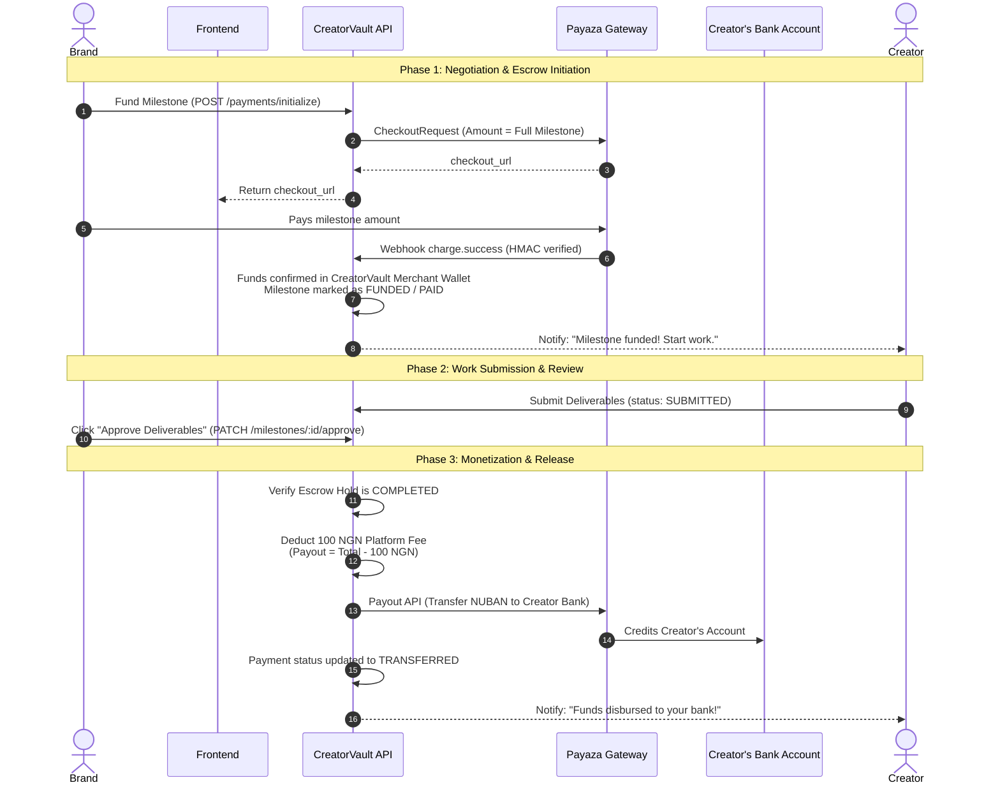

# 🛡️ CreatorVault — Escrow Architecture & Implementation Guide

This document is the official architectural blueprint and operational reference for CreatorVault's **Escrow Payment System**. It details how funds are captured, held in centralized custody, and automatically disbursed while securing platform monetization.

---

## 1. System Overview

CreatorVault functions as a trusted financial intermediary between **Brands** and **Creators**. 

To protect creators from non-payment and brands from undelivered milestones:
1. **Brand Funds Upfront**: Money is collected prior to milestone execution and held securely in CreatorVault's merchant wallet.
2. **Escrow Custody**: Payaza acts as the underlying gateway; CreatorVault's centralized merchant account acts as the holding vault.
3. **Automated Release & Monetization**: Upon milestone approval by the brand, the platform deducts a flat **100 NGN platform fee** (accumulated revenue) and transfers the remainder directly to the creator's Nigerian bank account (NUBAN).

---

## 2. End-to-End Escrow Sequence



---

## 3. The 3 Lifecycle Phases

### Phase 1: Escrow Funding & Inflow (Collection)
1. **Initiation**: The brand agrees to fund an approved milestone and triggers:
   * `POST /api/v1/payments/initialize`
2. **Payaza Collection Request**:
   * **Endpoint**: `POST https://router-live.payaza.africa/api/v1/applications/initialize`
   * **Headers**: `Authorization: Payaza <PAYAZA_API_KEY>`
   * **Payload**:
     ```json
     {
       "service_type": "Account",
       "service_payload": {
         "request_application": "Payaza",
         "application_module": "USER_MODULE",
         "application_version": "1.0.0",
         "request_class": "CheckoutRequest",
         "connection_map": {
           "amount": 50000,
           "checkout_amount": 50000,
           "currency_code": "NGN",
           "email_address": "brand@example.com",
           "first_name": "Brand",
           "last_name": "Rep",
           "transaction_reference": "ESCROW_HOLD_1710764400000_123",
           "callback_url": "https://creatorvault.app/payments/verify/ESCROW_HOLD_..."
         }
       }
     }
     ```
3. **Custody & Webhook Verification**:
   * Brand pays via checkout.
   * Funds settle into CreatorVault's master merchant wallet.
   * Payaza sends webhook with `x-payaza-signature`.
   * Backend verifies HMAC SHA-512, sets `Payment.status = COMPLETED`, and marks `Milestone.status = PAID`.

---

### Phase 2: Work Execution & Milestone Review
1. The Creator is alerted that escrow is secured.
2. The Creator submits final deliverables (portfolio links, raw files, campaign analytics).
3. The Milestone status updates to `SUBMITTED`.
4. The Brand reviews submissions inside the dashboard.

---

### Phase 3: Payout Disbursement & Fee Retention (Outflow)
1. **Trigger**: Brand clicks **"Approve Milestone"** (`approveMilestone`).
2. **Platform Monetization**:
   $$\text{Creator Payout Amount} = \text{Milestone Amount} - 100\text{ NGN}$$
   * The **100 NGN** flat fee stays in CreatorVault's Payaza wallet as realized platform profit.
3. **Payaza Payout/Transfer API**:
   * **Endpoint**: `POST https://router-live.payaza.africa/api/v1/applications/payouts`
   * **Payload**:
     ```json
     {
       "transaction_type": "nuban",
       "transaction_reference": "ESCROW_RELEASE_1710764500000",
       "amount": 49900,
       "currency": "NGN",
       "destination_account": "0123456789",
       "destination_bank": "058",
       "narration": "CreatorVault Payout for Deal: Summer Brand Campaign"
     }
     ```
4. **Completion**:
   * Creator's bank account receives the transfer.
   * `Payment.status` is set to `TRANSFERRED`.
   * Milestone is marked `APPROVED` and closed.

---

## 4. Database Schema Support

Located in `backend/prisma/schema.prisma`:

```prisma
model BankAccount {
  id            String   @id @default(uuid())
  creatorId     String   @unique
  creator       User     @relation(fields: [creatorId], references: [id])
  bankCode      String   // CBN Bank Code (e.g., "058" for GTBank, "011" for First Bank)
  accountNumber String   // 10-digit NUBAN
  accountName   String   // Verified account name
  createdAt     DateTime @default(now())
  updatedAt     DateTime @updatedAt
}

model Payment {
  id          String          @id @default(uuid())
  dealId      String
  milestoneId String?         @unique
  payerId     String          // Brand User ID
  payeeId     String          // Creator User ID
  amount      Decimal         @db.Decimal(12, 2)
  currency    String          @default("NGN")
  status      PaymentStatus   @default(PENDING) // PENDING -> COMPLETED (Held in Escrow) -> TRANSFERRED (Released)
  provider    PaymentProvider @default(PAYAZA)
  providerRef String          @unique
  paidAt      DateTime?
  createdAt   DateTime        @default(now())
  updatedAt   DateTime        @updatedAt
}
```

---

## 5. Security & Edge Case Handling

1. **Dispute Freeze**: If either party files a dispute (`POST /api/v1/disputes`), all payout release routines for that milestone are blocked.
2. **HMAC Webhook Validation**: All webhook payloads are cryptographically signed using SHA-512 with `PAYAZA_SECRET_KEY` to prevent spoofed payments.
3. **Idempotency**: All payout references use unique identifiers (`ESCROW_RELEASE_<timestamp>`) to guard against duplicate bank transfers on retries.
4. **Minimum Balance Check**: Milestones smaller than or equal to the platform fee (≤ 100 NGN) are rejected by validation logic.

---

## 6. Key Code Locations

* **Escrow Payment Logic**: `backend/src/modules/payments/payments.service.ts`
* **Payaza Webhook**: `backend/src/modules/payments/payments.webhook.ts`
* **Milestone Approval Hook**: `backend/src/modules/milestones/milestones.service.ts`
* **Database Models**: `backend/prisma/schema.prisma`

---

## 7. Frontend Integration Checklist

- [ ] **Creator Settings**: Bank details form to submit `bankCode`, `accountNumber`, and `accountName`.
- [ ] **Brand Deals View**: "Fund Milestone" button redirecting to Payaza `checkoutUrl`.
- [ ] **Brand Review View**: "Approve Deliverables" button triggering `approveMilestone`.
